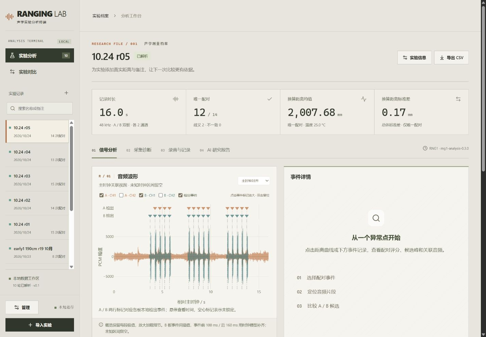
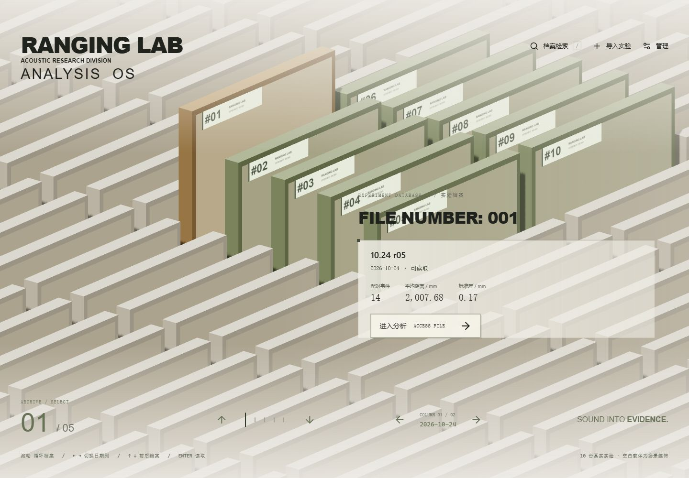
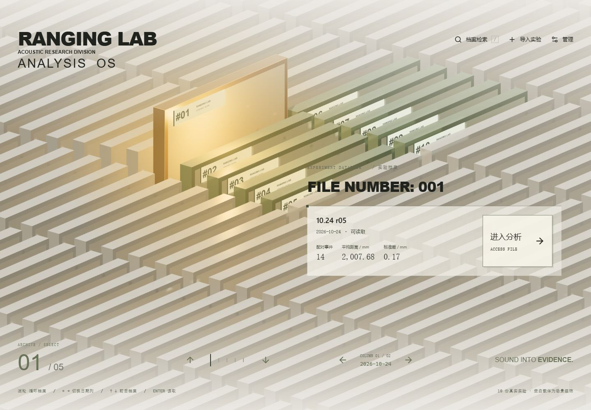

# 莱茵风格界面实验

日期：2026-10-28。网页子仓库和主工程均使用 `wlf/rhine-ui` 分支；基于网页稳定版本 `4ad7d46` 开发，仅本地试用，不代表线上发布。

## 视觉与功能

参考用户提供的 `E:\临时\风格参考`（[RhineLabUI](https://github.com/LBEILC/RhineLabUI)）的暖灰纸面、细线排版、实体档案载体和科研终端构图。新增界面、档案几何体及标识自行实现；没有复制参考项目的源码、模型、授权字体、音频或莱茵生命品牌标志。本轮引入Three.js 0.183，场景按需加载，使用实例化卡片与按需重绘。

- 首页改为全屏实验档案阵列：暖白立体卡片斜向铺满视野，选中档案抬起，右侧浮层显示真实实验名称、导入日期及统计摘要，点击“进入分析”进入工作台。空白载体仅作场景装饰，不虚构实验。
- 按导入日期分列，底部提供前后记录、日期列和记录刻度导航。支持方向键、Enter读取、斜杠检索及触屏滑动；检索可匹配名称、备注和日期。顶部保留导入与管理入口。检索使用原生模态窗口，支持Esc关闭及焦点返回。
- 无WebGL或图形上下文丢失时采用静态背景，选择控件仍可使用。场景离开页面时释放图形资源；支持减少动态效果和后台暂停。
- 分析工作台采用暖白/橄榄灰配色、直角面板和等宽数值。A板使用铜橙色，B板使用青绿色，波形与检出事件标记一致；保留原来的透明波形叠加。
- 波形移到图表列首位，距离图位于其下；事件详情在宽屏仍占相同宽度。配对联动、事件标记和两种时间基准保持原来的计算口径。
- “录音与记录”优先展示A/B播放和下载；完整解析日志与PCM逐帧数据收进“展开完整解析记录”。采集诊断、多轮对比、AI报告与受密码保护的管理页继续可用。
- 桌面保留实验侧栏；手机改为实验下拉选择和对比入口。动画用于档案切换和悬停，支持系统“减少动态效果”，无自动播放声音。
- 将React入口与App组件分开以支持正常热更新，避免重复创建根节点；图表尺寸回调忽略已卸载的图表，保留有效图表的异常报告。

## 本地运行与回退

已安装依赖的电脑，双击网页工具根目录的 `start-local.cmd`，打开 `http://127.0.0.1:8000`。页面默认进入档案库，点击选中记录下方“进入分析”。完整依赖准备方法仍见根目录README。

切换分支不会自动重建被Git忽略的 `frontend/dist/`。如需回到原界面，先停止本地服务并确保工作区修改已保存；在主工程切回稳定分支、更新子模块，再在网页目录构建：

```powershell
# 主工程根目录
git switch release
git submodule update --init -- tools/web_tools
Set-Location tools/web_tools/frontend
npm.cmd run build
```

构建后重新运行 `start-local.cmd`。两版沿用同一套本地 `data/` 与私有配置；本次没有改变数据库结构、后台接口、AI请求内容或服务器发布。不要为切换UI删除实验数据。

## 验证

- 前端8项测试通过（4项事件标记、4项档案分组与导航），TypeScript检查及Vite生产构建通过。构建仍提示既有Plotly图表包体积较大，不影响构建成功。
- 使用本地10轮实验检查档案检索/切换、进入分析、配对选择后波形定位、双板播放器互斥、解析记录展开和两轮实验统计对比。
- 浏览器检查1440px宽屏双列和390px窄屏；窄屏档案、分析及对比页面无整页横向溢出。长表格保留自身滚动区域。
- 检查导入弹窗的字段与无文件禁用提交状态；没有额外导入或删除正式实验，没有提交付费AI请求。
- 浏览器检查采集诊断、AI页面和管理入口；完整上传解析/AI供应商调用/管理写操作沿用稳定版，本次不重复进行这些会改变数据的操作。
- 最终生产构建通过本地8000端口复核，重复切换分析/诊断/录音页面并调整桌面与手机尺寸，浏览器未再报告错误。
- 后端源码未修改，本次不重跑后端与固件回归，不构成新的硬件验收。

预览截图：


[手机档案页](screenshots/rhine-archive-mobile-2026-10-28.jpg)

## 全屏档案阵列复核（2026-10-28）

本轮复核真实10份实验的前后选择、日期列切换、检索无结果/精确匹配、进入分析，以及1440×1000桌面和390×844手机布局。新增Three.js场景约503kB（gzip约128kB），单独按需加载；构建仍有图表和场景包体积提示。没有修改后端、实验数据或线上站点。


[手机全屏档案](screenshots/rhine-archive-array-mobile-2026-10-28.jpg)

## 档案清晰度与页面过渡（2026-10-28）

- 桌面卡片视觉尺寸增加约31%，手机增加25%；厚度由0.23增加到0.38，行间距由0.67增加到0.88。暖灰边框、降低环境补光和增强主光对比，让卡片边缘及阴影更清晰。右侧信息底色同步增强。
- 档案、分析、对比、管理及分析子页使用约360ms的淡入与轻微位移动画。使用浏览器View Transition截图过渡，不为动画重复挂载页面；快速切换以最后一次选择为准。不支持该接口时采用280ms入场过渡，系统减少动态效果时直接切换。
- 8项前端测试和生产构建通过；浏览器复核桌面与390px手机布局、档案进入分析、诊断/录音/信号页面切换，无新增浏览器错误或警告。保留既有包体积提示。


## 滚轮遍历档案（2026-10-28）

首页滚轮向下/向上按阵列顺序遍历全部实验，跨日期列并首尾循环；累计小幅滚动，切换间隔至少450ms，避免触控板连续事件过快跳转。检索/导入窗口及浏览器缩放手势不触发档案选择。9项前端测试、生产构建通过；浏览器实测第一份向上到第10份、向下回到第一份，检索窗口滚动不改变选择，无浏览器报错。

## 操作入口与状态配色（2026-10-29 存档）

- 首页“进入分析”增加边框、浅色底和悬停反馈。
- 配对时差与距离的事件点及图例使用低饱和绿（唯一配对）、黄（歧义）、红（不一致）。
- 桌面移除重复的RANGING品牌，将RANGING LAB放到侧栏左上角；管理、运行状态和导入集中到左下角。手机保留顶部品牌，并使用底部操作栏。
- TypeScript检查和生产构建通过；桌面及390px手机浏览器检查布局、配对图颜色、管理与导入入口，无浏览器错误或警告。已有包体积提示仍保留。本轮为样式和布局调整，未新增测试，未部署线上。



[首页按钮效果](screenshots/rhine-archive-button-2026-10-28.jpg)

## 真实档案编号与快速滚轮（2026-10-29）

真实实验对应的卡片采用浅橄榄卡面、深色边框并整体抬高；选中卡片进一步抬升并使用暖金色。空白载体降低高度、使用中性色且不显示标签。每份真实档案在模型左上角绘制独立的#01等编号，编号与右侧FILE NUMBER共用实验列表顺序；记录变化时更新标签并释放旧纹理。增大前后间距，减少编号被遮挡。

滚轮节流从450ms缩短至140ms，小幅滚动触发门槛从30降至18，保留跨日期遍历及首尾循环。9项前端测试和生产构建通过；浏览器检查10份档案、#01到#10首尾切换、桌面和390px手机，无控制台错误。既有构建包体积提示保留，未部署线上。



## 间距恢复与本地启动更新（2026-10-29）

按反馈取消真实档案整体抬高、恢复0.88前后间距，保留原来的选中弹出与邻近过渡，以及卡片编号和配色。start-local.cmd调用的启动器新增源码指纹检查：源码变化时自动构建，不变时复用；检查服务返回的首页与当前构建一致，并以构建标识打开页面，减少旧页面缓存影响。旧服务返回其他构建时提示关闭旧服务，不自动终止未知进程。

已验证源码变化检测、构建缓存排除、不变时跳过构建、实际构建启动及现有服务页面核对；浏览器确认恢复后的卡片间距和选中编号。后续按用户要求，仅在较大变更完成时创建Git检查点，不再为每次微调提交。

## 右侧入口与透光发光卡片（2026-10-29，工作区调整）

“进入分析”移至摘要面板右侧，中文和英文分两行，箭头居右；窄屏保持右侧布局并允许左侧名称/统计换行。卡片采用物理透光材质，选中项增加金色轮廓、柔和光晕与局部照明，光效跟随选择。保持原有高度和间距、140ms滚轮间隔。参考用户提供的播放器效果截图自行实现，未拉取或运行第三方工程。

生产构建通过；浏览器核对1440px桌面及390px手机、长名称布局、滚轮跨列选择、右侧按钮进入波形分析，无横向溢出或控制台错误。场景静止时仍按需渲染，新增图形资源随页面卸载释放。构建保留包体积提示。本次在本地完成，随后纳入统一发布检查点。



## 2026-10-29 发布检查点

按用户要求，将间距恢复、本地启动自动构建、右侧分析按钮、透光材质与选中光效统一提交，并准备发布至现有腾讯云站点。发布包不包含本地数据、密钥或管理密码；服务器使用独立新发布目录，保留原发布供回退。实际部署结果记录在主工程的发布日志中。
